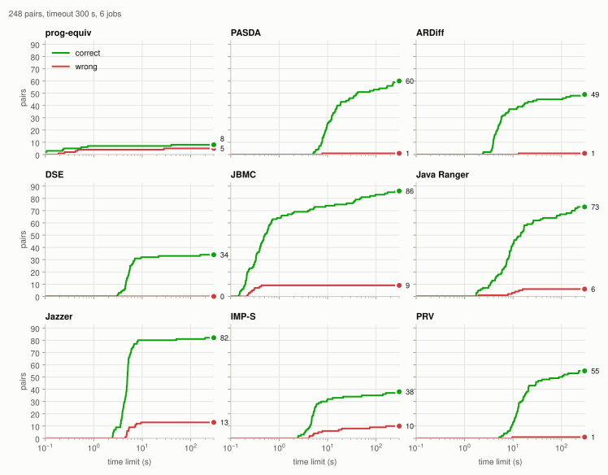
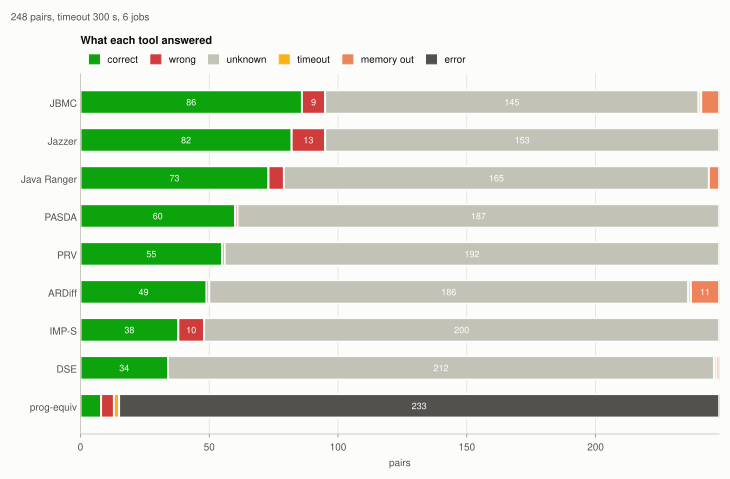
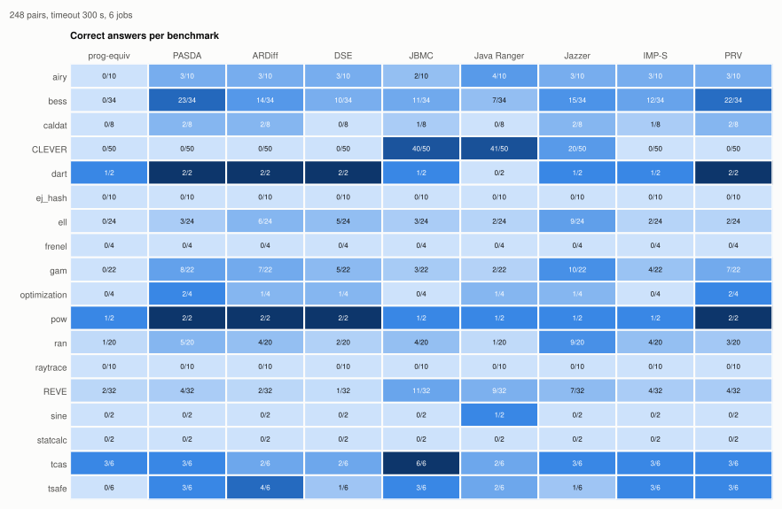
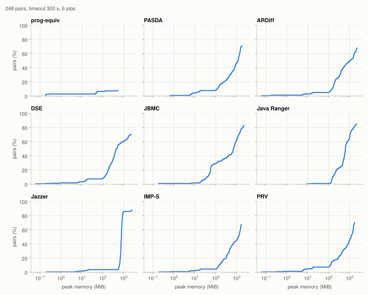
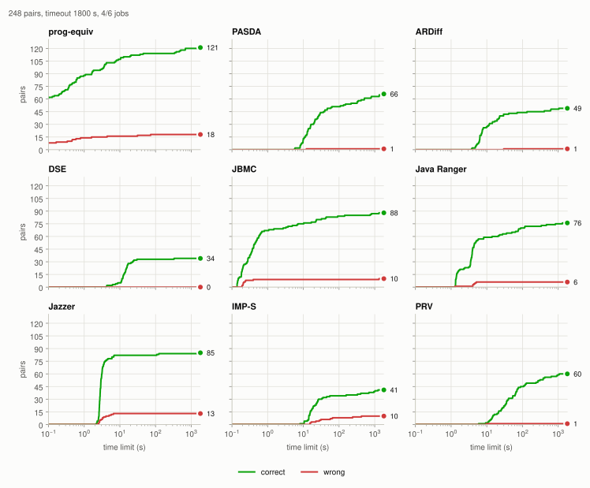
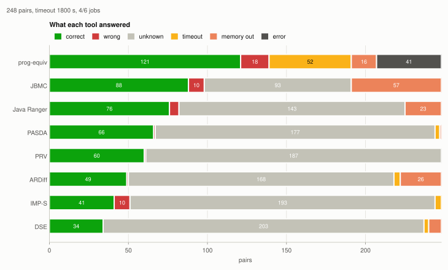
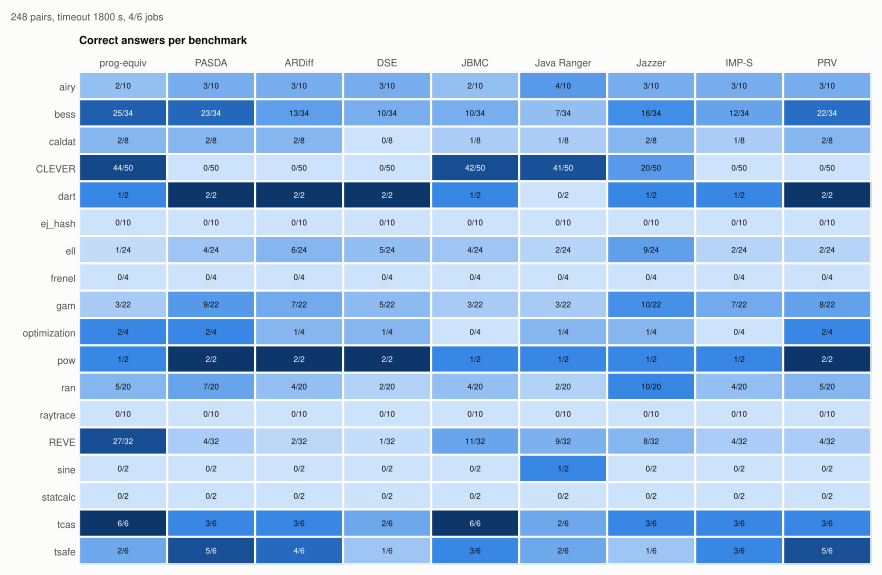
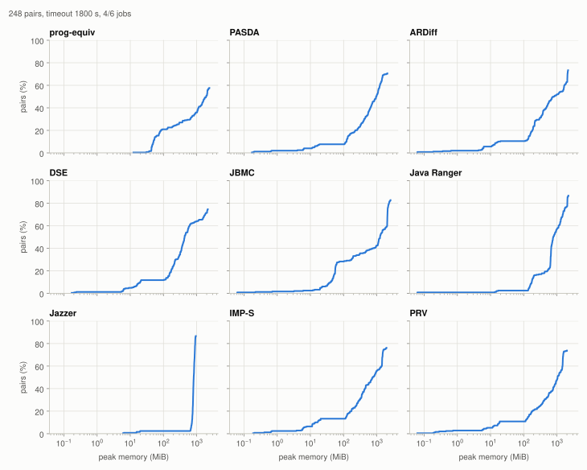

# Reference tools

Equivalence checkers to evaluate on the 248 method-level pairs with `eqbench analyse`.
Each tool gets its own `tools/<tool>/` directory with a `flake.nix` and an
adapter script that turns its output into `eq` / `neq` / `unknown`, so that the
root flake stays small.

```sh
just eqbench analyse ./eqbench/tools/pasda               # PASDA
just eqbench analyse ./eqbench/tools/pasda --tool ARDiff  # ARDiff, DSE, IMP-S, PRV
just eqbench analyse ./eqbench/tools/jbmc
just eqbench analyse ./eqbench/tools/java-ranger
just eqbench analyse ./eqbench/tools/jazzer
```

`analyse` builds the flake of the directory with nix before the first case,
then runs the only program of its default package with the given arguments.

| Tool | Status |
|---|---|
| [PASDA, ARDiff, DSE, IMP-S, PRV](pasda) | Done, tested on macOS (aarch64), not on Linux yet. ARDiff, DSE, IMP-S and PRV are the versions fixed or written by the authors of PASDA, run from the same build with `--tool`. The adapter makes the compared method the first, static `snippet` method of its class and the other members static, as PASDA requires. They answer `unknown` for `void` methods, non-primitive parameters, methods outside `oldV` / `newV` pairs PASDA's instrumentation cannot handle, and pairs whose compared method calls a method of its class changed between the versions (all of CLEVER, a few others): these tools analyse the compared method only, calls being the same uninterpreted function in both versions, so they would miss the change. `--budget` (default: one second below the timeout of `analyse`) and `--depth` (default 10) can be passed too. |
| [JBMC](jbmc) | Done. CBMC 6.11.0 of nixpkgs rebuilt with JBMC (about 25 min the first time). Checks the miter, `eqbench.Miter.check` on every input, unwinding loops and recursion up to a bound that doubles from 1: `eq` once every unwinding assertion holds, `neq` on a counterexample once the JVM confirms it (`EqbenchReplay` runs the miter on its inputs), `unknown` when the JVM does not: JBMC's models of the Java library are not exact (`Math.log` returns any value, a method without a body anything). |
| [Java Ranger](java-ranger) | Done. The SV-COMP 2027 build, whose Z3 is x86-64 only: Apple Silicon runs it with an x86-64 JDK 8 through Rosetta. Runs `eqbench.Miter.main` with symbolic inputs and its SV-COMP configuration (doubles in [-2^31, 2^31]), the search depth doubling from 16: `neq` on an `AssertionError`, `eq` once every path is explored without reaching the depth limit. |
| [Jazzer](jazzer) | Done, macOS only (the official release of the launcher). Fuzzes `eqbench.Miter.check`: `neq` when the versions differ on a fuzzed input, which is printed, `unknown` otherwise. |

## Results

The 248 pairs at 300 s per pair, 6 pairs at a time, at most 2 GiB per tool,
on an Apple M1 Pro (8 cores, 16 GB). With them, `prog-equiv`, the analyser of
this repository (`target/release/prog-equiv`), at master 6abae1f and 3 pairs at
a time. The records are in
[`../results`](../results), one JSON line per pair; the plots are made by
`just eqbench-plot eqbench/results/*-300.jsonl`.

| Tool | Correct | F1 | eq precision / recall | neq precision / recall | unknown | timeout | memory out | error | Mean time | Max memory |
|---|---|---|---|---|---|---|---|---|---|---|
| prog-equiv | 115/248 | 0.596 | 0.897 / 0.519 | 0.818 / 0.398 | 0 | 60 | 14 | 41 | 81.6 s | 2274 MiB |
| JBMC | 86/248 | 0.494 | 1.000 / 0.207 | 0.866 / 0.513 | 145 | 1 | 7 | 0 | 109.0 s | 2182 MiB |
| Jazzer | 82/248 | 0.394 | - / 0.000 | 0.863 / 0.726 | 153 | 0 | 0 | 0 | 139.5 s | 944 MiB |
| Java Ranger | 73/248 | 0.448 | 0.974 / 0.274 | 0.878 / 0.319 | 165 | 0 | 4 | 0 | 130.9 s | 2079 MiB |
| PASDA | 60/248 | 0.392 | 0.960 / 0.178 | 1.000 / 0.319 | 187 | 0 | 0 | 0 | 68.4 s | 1795 MiB |
| PRV | 55/248 | 0.365 | 0.958 / 0.170 | 1.000 / 0.283 | 192 | 0 | 0 | 0 | 64.8 s | 1721 MiB |
| ARDiff | 49/248 | 0.327 | 0.966 / 0.207 | 1.000 / 0.186 | 186 | 1 | 11 | 0 | 43.9 s | 2205 MiB |
| IMP-S | 38/248 | 0.258 | 0.875 / 0.104 | 0.750 / 0.212 | 200 | 0 | 0 | 0 | 51.7 s | 1664 MiB |
| DSE | 34/248 | 0.241 | 1.000 / 0.141 | 1.000 / 0.133 | 212 | 1 | 1 | 0 | 24.1 s | 2228 MiB |

Correct and wrong answers by time limit: a tool answers the same within any
larger limit, so one run at 300 s gives every limit below it.

<picture>
  <source media="(prefers-color-scheme: dark)" srcset="../results/plots/answers-300-dark.svg">
  
</picture>

<picture>
  <source media="(prefers-color-scheme: dark)" srcset="../results/plots/quality-300-dark.svg">
  
</picture>

<picture>
  <source media="(prefers-color-scheme: dark)" srcset="../results/plots/benchmarks-300-dark.svg">
  
</picture>

<picture>
  <source media="(prefers-color-scheme: dark)" srcset="../results/plots/memory-300-dark.svg">
  
</picture>

- **174 of the 248 pairs** (87 `Eq`, 87 `Neq`) get a correct answer from at
  least one tool, 146 without `prog-equiv`. `prog-equiv` is the only one right
  on 28 of them, Jazzer on 13, Java Ranger on 4. Nobody answers on ej_hash,
  frenel, raytrace and statcalc: `void` methods, classes other than `oldV` /
  `newV` or without a constructor without parameters, outside both the miter
  and PASDA's input format, and on which `prog-equiv` crashes.
- **Of the other tools, the miter tools are the best and the fastest to
  answer**: JBMC answers most of its pairs within a second, Jazzer finds its
  differences within 10 s. Only they and `prog-equiv` (44) answer on CLEVER
  (JBMC 40, Java Ranger 41, Jazzer 20 of the 50 pairs), whose changes are in a
  callee the PASDA family does not look into.
- **13 `Eq` pairs differ on the JVM** (below): integer overflows, NaN and
  infinities, and two pairs that differ on small inputs. Every `neq` of JBMC,
  Jazzer and `prog-equiv` on an `Eq` pair is one of them, run on the JVM. They
  count as wrong above, against EqBench's labels; counted as `Neq`, JBMC and
  Jazzer both have 95 correct answers and no wrong one, PASDA 57 and 4 (`eq` on
  airy-MAX, dart-test and pow-test, and on `ran-ranzero-Neq`), `prog-equiv` 124
  and 9 (its 8 wrong `eq` and `eq` on REVE-limit3-Eq).
- **Java Ranger** misses NaN, its solver reasoning on doubles as reals, and an
  overflow: `eq` on airy-MAX, airy-Sign, bess-SIGN and CLEVER-multiple, a wrong
  `eq` on `sine-mysin-Neq`. Its `neq` on `CLEVER-is_prime3-Eq` has no witness on
  the JVM.
- **The PASDA family** answers `unknown` on the 57 pairs whose compared method
  calls a changed method (all of CLEVER). The wrong `eq` on `ran-ranzero-Neq` is
  shared by PASDA, ARDiff, IMP-S and PRV. IMP-S answers `neq` on 7 `Eq` pairs
  where no other tool finds a difference.
- **`prog-equiv`** answers `eq` whenever it finds no difference among at most
  20 paths of at most 1000 instructions per version, even when traces do not
  finish. Its 42 `eq` after a complete exploration are all right, among them
  CLEVER-is_prime3-Eq, bess-bessk1-Eq and ran-gammln-Eq, which no other tool
  proves. 34 rest on unfinished traces: 8 are wrong, and 24 of the 28 pairs
  only `prog-equiv` gets right are among them, mostly REVE. Its 55 `neq` all
  come within 15 s and differ on the JVM; 10 of them are on the `Eq` pairs
  above. It crashes (exit 101) on 41 pairs: `System.out` (24,
  `interpreter/src/interpreter.rs:195`), classes other than `oldV` / `newV`
  (14), a class without a constructor without parameters (2) and an `int[]`
  parameter (1). Its 60 timeouts and 14 memory outs are spent in Z3, solving
  over floating point for the next input.
- **Memory**: Jazzer needs about 700 MiB per pair (a JVM and libFuzzer), at most
  944 MiB; 2 GiB stops `prog-equiv` on 14 pairs, ARDiff on 11, JBMC on 7. Peaks
  are sampled every 250 ms, a little above the limit before the tool is stopped.
- After the JBMC adapter started to confirm counterexamples on the JVM and the
  miter to skip stack overflows, JBMC was run again in full, Java Ranger and
  Jazzer on the pairs they had answered `neq`: their other answers cannot change.
- Jazzer was run again on the 44 pairs whose versions print, e.g. an error
  message in gam-factln: its adapter held their output in memory, millions of
  lines, and timed out on 4 of them and went over 2 GiB on 5. It now drops what
  the versions print; the same 10 of them are answered `neq`, the others
  `unknown`.

### `Eq` pairs that differ on the JVM

Each found by Jazzer or JBMC, then run on both versions.

| Pair | Inputs | Old | New | Why |
|---|---|---|---|---|
| CLEVER-fib-Eq | 2 | 1 | 2 | The loop does `a = b; b = a + b`: not Fibonacci |
| CLEVER-is_prime2-Eq | 19 | `false` | `true` | 19 is in `primes`: `x % 19 == 0` against `x == 19` |
| CLEVER-ltfive-Eq | 1610612737 | 0 | -1 | `(x + 1) * 5` overflows |
| CLEVER-multiple-Eq | -922065910 | 0 | 1 | `x * 5 * 6` overflows |
| CLEVER-oneN2-Eq | -2147483648 | -2147483648 | 2147483647 | `Integer.MIN_VALUE` |
| REVE-limit3-Eq | 65829 | -2128205761 | -2147450880 | The sum overflows |
| dart-test-Eq | -791621424, 10 | 0.0 | 1000.0 | `x * x * x > 0` overflows |
| pow-test-Eq | 973078528, -2147483648 | 14 | 13 | `-y < -8` against `y > 8` |
| airy-MAX-Eq | NaN, 0.0 | NaN | 0.0 | NaN |
| airy-Sign-Eq | -3.38e307, NaN | -3.38e307 | 3.38e307 | NaN |
| bess-SIGN-Eq | -1.12e307, NaN | -1.12e307 | 1.12e307 | NaN |
| ell-ellpi-Eq | 2.23e-308, 0.0, -1.66e308 | NaN | 1.22e-308 | Arguments out of range |
| gam-gser-Eq | 1.67e305, 1.80e308, -1.80e308 | Infinity | -1.80e308 | Overflow to infinity |

### At 1800 s

The same 248 pairs at 1800 s per pair, at most 2 GiB per tool, 6 pairs at a
time, 4 for JBMC and Java Ranger: 6 of them at 2 GiB do not fit in 16 GB.
`prog-equiv` is the version of master, 6abae1f, as at 300 s. The plots are made
by `just eqbench-plot eqbench/results/*-1800.jsonl`.

| Tool | Correct | F1 | eq precision / recall | neq precision / recall | unknown | timeout | memory out | error | Mean time | Max memory |
|---|---|---|---|---|---|---|---|---|---|---|
| prog-equiv | 121/248 | 0.621 | 0.899 / 0.526 | 0.833 / 0.442 | 0 | 52 | 16 | 41 | 425.5 s | 2417 MiB |
| JBMC | 88/248 | 0.501 | 1.000 / 0.215 | 0.855 / 0.522 | 93 | 0 | 57 | 0 | 281.6 s | 2591 MiB |
| Jazzer | 85/248 | 0.403 | - / 0.000 | 0.867 / 0.752 | 150 | 0 | 0 | 0 | 813.7 s | 945 MiB |
| Java Ranger | 76/248 | 0.462 | 0.975 / 0.289 | 0.881 / 0.327 | 143 | 0 | 23 | 0 | 534.8 s | 2207 MiB |
| PASDA | 66/248 | 0.422 | 0.964 / 0.200 | 1.000 / 0.345 | 177 | 3 | 1 | 0 | 290.4 s | 2088 MiB |
| PRV | 60/248 | 0.392 | 0.960 / 0.178 | 1.000 / 0.319 | 187 | 0 | 0 | 0 | 297.6 s | 2007 MiB |
| ARDiff | 49/248 | 0.327 | 0.966 / 0.207 | 1.000 / 0.186 | 168 | 4 | 26 | 0 | 152.2 s | 2168 MiB |
| IMP-S | 41/248 | 0.276 | 0.882 / 0.111 | 0.765 / 0.230 | 193 | 4 | 0 | 0 | 262.9 s | 1960 MiB |
| DSE | 34/248 | 0.241 | 1.000 / 0.141 | 1.000 / 0.133 | 203 | 3 | 8 | 0 | 102.3 s | 2164 MiB |

<picture>
  <source media="(prefers-color-scheme: dark)" srcset="../results/plots/answers-1800-dark.svg">
  
</picture>

<picture>
  <source media="(prefers-color-scheme: dark)" srcset="../results/plots/quality-1800-dark.svg">
  
</picture>

<picture>
  <source media="(prefers-color-scheme: dark)" srcset="../results/plots/benchmarks-1800-dark.svg">
  
</picture>

<picture>
  <source media="(prefers-color-scheme: dark)" srcset="../results/plots/memory-1800-dark.svg">
  
</picture>

- **The times of the PASDA family are inflated.** The machine was short of
  memory: 6 JVMs of about 1.6 GB each and the other applications filled the
  16 GB, and up to two thirds of the CPU time went to the system, compressing
  and swapping memory. An answer given in both runs took a median 1.4 times
  longer than at 300 s for PASDA, 1.7 for ARDiff, 2.5 for DSE, 3.4 for IMP-S
  and 2.7 for PRV. An answer after 300 s here does not show that 300 s is too
  short: of the 11 PASDA gives, it gave 5 within 300 s in the run at 300 s, PRV
  3 of its 8. JBMC and Java Ranger, 4 pairs at a time once the machine had
  memory to spare, took 0.68 and 0.44 times as long as at 300 s, and Jazzer
  0.64: the series at 300 s was short of memory too.
- **A larger timeout answers a few more pairs**, and loses one:
  - PASDA gets 6 more right than at 300 s, between 509 and 1515 s:
    ell-plgndr-Eq, gam-expint-Neq and both pairs of ran-ranone and of
    tsafe-snippet.
  - `prog-equiv` gets 6 more than at 300 s, between 378 and 1781 s:
    REVE-loop-Eq, gam-ei-Neq and the `Neq` pairs of bess-bessj0, bessk0, bessk1
    and bessy0. It times out on 52 pairs instead of 60.
  - PRV gets 5 more, between 379 and 1074 s: gam-gser-Neq, ran-gamdev-Neq,
    ran-poidev-Neq and both pairs of tsafe-snippet.
  - IMP-S gets 3 more, between 944 and 1236 s: both pairs of gam-gcf and
    gam-gser-Neq.
  - Java Ranger gets 3 more, between 466 and 1313 s: caldat-julday-Eq,
    gam-gser-Neq and ran-gammln-Eq.
  - JBMC gets 3 more, between 747 and 1319 s: CLEVER-is_prime1-Neq,
    CLEVER-is_prime3-Eq and ell-rf-Neq. It loses bess-bessk1-Neq, answered in
    152 s at 300 s, which goes over 2 GiB in 31 s. Its one new wrong answer,
    `neq` on CLEVER-is_prime2-Eq at 1320 s, is one of the 13 `Eq` pairs that
    differ on the JVM.
  - Jazzer gets 3 more: REVE-ackermann-Neq at 1769 s, and bess-bessi-Neq and
    ran-bnldev-Neq within 3 s, which it missed at 300 s since its inputs are
    random. Its 13 wrong answers are the same, `neq` on the 13 `Eq` pairs that
    differ on the JVM.
  - DSE gets the same 34 right. No other tool gives a new wrong answer.
- **ARDiff** gets as many right (49). It is given the time left (`--t`), and
  with 1800 s, 15 more pairs go over 2 GiB (26). 7 of them do so within 3 min,
  where at 300 s ARDiff ran to the timeout. bess-bessy-Neq, answered `neq` in
  18 s at 300 s, goes over 2 GiB in 18 s; tcas-altseptest-Neq is answered
  instead, at 1045 s.
- **JBMC goes over 2 GiB on 57 pairs**, against 7 at 300 s, 18 of them within
  3 to 8 s. At 300 s, 15 of these 18 answered `unknown` at the deadline,
  peaking at 1.0 to 1.9 GiB. JBMC does the same work in its first seconds
  whatever the timeout, its unwinding bound doubling from 1, so the difference
  is in the measure: at 300 s, 6 pairs at a time, macOS compressed part of the
  memory, which resident memory leaves out. Java Ranger goes over 2 GiB on 23
  pairs against 4, DSE on 8 against 1.
- **Memory**: the peaks, and the 2 GiB limit, are on resident memory, which
  leaves out what macOS compressed or swapped. Under the load of the PASDA
  family they understate what the JVMs held.
- **`prog-equiv`** gives the same 18 wrong answers as at 300 s, and crashes on
  the same 41 pairs.

## Shortlist

In integration order: cheapest and most informative first.

| # | Tool | Approach | Can answer | Code |
|---|---|---|---|---|
| 1 | PASDA, ARDiff, DSE, PRV | Symbolic execution (SPF + Z3) of both versions, summary or partition based | eq, neq, maybe, unknown | [glockyco/PASDA](https://github.com/glockyco/PASDA) (MIT) |
| 2 | Differential fuzzing (Jazzer or JQF) | Fuzz a miter `old.m(x) == new.m(x)` | neq, unknown | [Jazzer](https://github.com/CodeIntelligenceTesting/jazzer) (Apache-2.0), [JQF](https://github.com/rohanpadhye/JQF) (BSD-2) |
| 3 | JBMC | Bounded model checking of the miter's bytecode | neq; eq when loops are fully unwound | [diffblue/cbmc](https://github.com/diffblue/cbmc) |
| 4 | GDart, Java Ranger, SWAT | Dynamic symbolic / symbolic / concolic execution of the miter | neq; eq when every path is explored | [GDart](https://github.com/tudo-aqua/gdart), [Java Ranger](https://github.com/vaibhavbsharma/java-ranger), [SWAT](https://github.com/SWAT-project/SWAT) (BSD-2) |
| 5 | Hybrid Eq/Neq | ARDiff / PASDA combined with differential fuzzing | eq, neq, likely | [laboni68/HybridNonEqAnalysis](https://github.com/laboni68/HybridNonEqAnalysis) (no license) |
| 6 | Randoop, EvoSuite | Test generation on the miter | neq, unknown | [Randoop](https://github.com/randoop/randoop) (MIT), [EvoSuite](https://github.com/EvoSuite/evosuite) (LGPL-3.0) |
| 7 | HyDiff | Fuzzing and shadow symbolic execution in parallel | neq, unknown | [yannicnoller/hydiff](https://github.com/yannicnoller/hydiff) (MIT) |

### PASDA, ARDiff, DSE, PRV

- PASDA: Glock, Pichler, Pinzger, JSS 2024 ([arXiv:2311.08071](https://arxiv.org/abs/2311.08071)).
  ARDiff: Badihi et al., ESEC/FSE 2020, by the authors of EqBench.
- One Java 8 build of the PASDA repo gives PASDA and bug-fixed versions of ARDiff,
  DSE and PRV (`PASDA-diff`, `ARDiff-base`, `DSE-base`, `SE-diff`). The original
  ARDiff ([resess/ARDiff](https://github.com/resess/ARDiff), inactive since 2021,
  also ships IMP-S) reports false `NEQ` that PASDA's README documents.
- `CheckPair.sh <dir> [timeout] [depth]` checks one pair. Both versions must be
  `oldV` / `newV` classes with a static `snippet` method of the same signature,
  so the adapter has to bring the method under comparison to that shape.
- Published results are on the ARDiff benchmark, which overlaps EqBench but is
  not the same set of pairs.

### Differential fuzzing

The cheapest baseline. It can only show non-equivalence, which is the hard side
for the symbolic tools.

### JBMC

First of the Java category of [SV-COMP 2026](https://sv-comp.sosy-lab.org/2026/results/results-verified/).
It takes a miter: a `Main` drawing inputs with `Verifier.nondet*()` and asserting
that both versions agree. The `cbmc` package of nixpkgs is built without JBMC
(`-DWITH_JBMC=OFF`), so the flake has to override it or use the SV-COMP archive.

### GDart, Java Ranger, SWAT

Same miter format as JBMC (SV-COMP), so each one is mostly a matter of wrapping
its SV-COMP archive. GDart is second in SV-COMP 2026 Java.

### Hybrid Eq/Neq

Sarker & Bultan, ICST 2025. A fork of the ARDiff / PASDA code with fuzzing added,
and the only tool with published runs on EqBench Java pairs. Research code without
a license.

### Randoop, EvoSuite

Neq-only baselines from test generation. Randoop is in nixpkgs.

### HyDiff

Noller et al., ICSE 2020. Every pair needs a hand-written fuzzing driver and a
merged `change(old, new)` program, hence last.

## Left out

- C only: SymDiff, RVT, REVE / llrêve, CLEVER, ModDiff, DiffKemp, shadow symbolic
  execution, UC-KLEE, PEQcheck.
- Plain SPF, JayHorn, JDart and COASTAL as miter checkers: negative scores in
  SV-COMP 2026 Java, i.e. many wrong answers.
- JLiSA (abstract interpretation, third in SV-COMP 2026 Java): unlikely to prove
  that two different computations agree; cheap to add later through the miter.
- No public code: the original DSE and PRV, DiSE.

## Work shared by the adapters

- **`unknown`**: most tools can answer it (`UNKNOWN`, `MAYBE_EQ`, depth limit...).
  The adapter prints `unknown`, which `analyse` counts as no prediction.
- **Method under comparison**: the tools need it, either by name, as `snippet`,
  or through a miter. `analyse` passes it as third argument: the `method` of
  `J-Desc.json`, or the entry point named by `program name` for CLEVER and REVE
  (`Sub.main` → `main`).
- **Miter**: `eqbench build` writes one for the 209 pairs whose method has
  primitive parameters and result (not the 26 `void` methods, raytrace's methods
  on objects, ...), and `analyse` gives its directory in `EQBENCH_MITER`.
  `eqbench.Miter.check(<params>)` calls both versions in neutral packages and
  asserts that they return the same value (NaN equals NaN, `-0.0` equals `0.0`)
  or both throw an exception (of any class: JBMC does not model the identity of `Class` objects); `main` calls it on `Verifier.nondet*()`
  inputs, as SV-COMP verifiers expect. An input on which a version runs out of
  stack or memory (`VirtualMachineError`) is skipped: when a recursion is twice
  as deep in one version, where the stack overflows depends on the JVM.
  Compiled for Java 8.
- **JDK**: the JPF-based tools need Java 8 (`jdk8` in nixpkgs).
- **Platform**: Java Ranger's SV-COMP archive ships Z3 for x86-64 only (Rosetta on
  Apple Silicon), Jazzer's launcher is the one released for macOS.


## TODO
- [x] Produce also a graph of "time to get an answer"
- [x] Maybe the memory used to for an execution 
- [ ] 